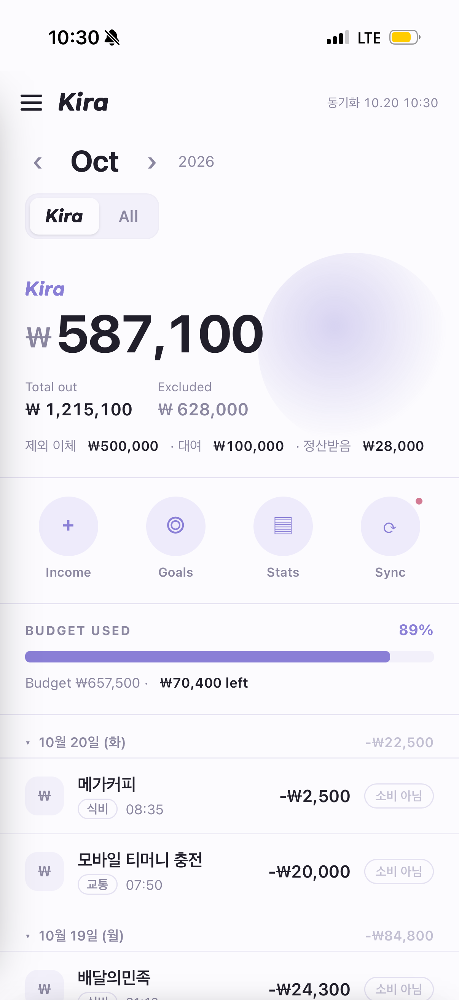
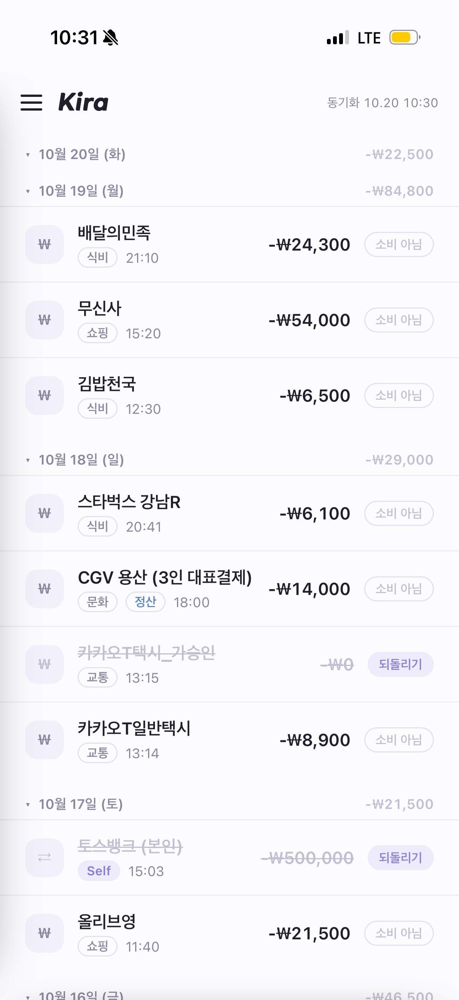
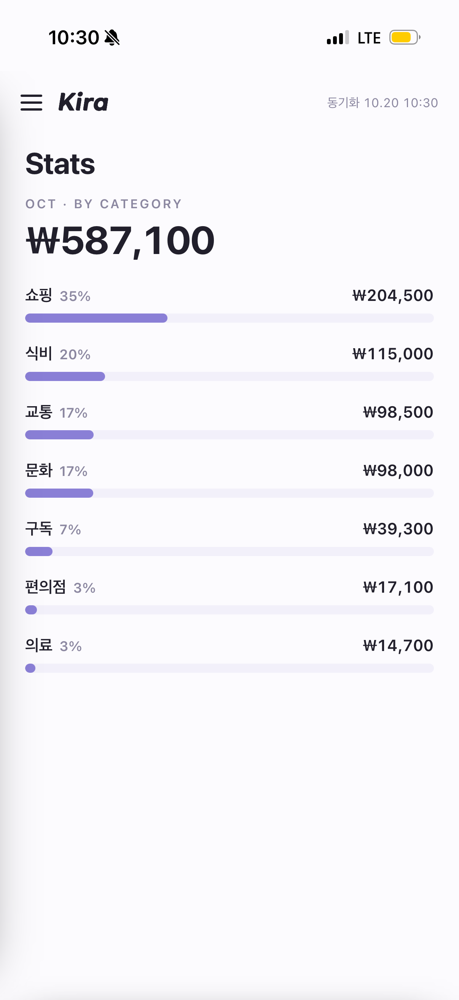
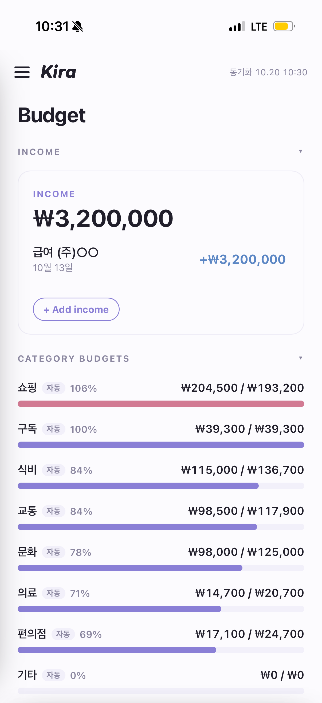

<div align="center">


# Kira

**통장에서 나간 돈이 아니라, 내가 *진짜* 쓴 돈을 보여주는 가계부**

여러 계좌(카카오뱅크·토스)를 한곳에서 — 자기 계좌 이체, 빌려준 돈, 대표로 결제하고 정산받은 돈을 걷어내고 *진짜 소비*만.

[라이브 데모](https://develu0825.github.io/Kira-MoneyApp/app/) · [GitHub](https://github.com/develu0825/Kira-MoneyApp) · [English](README.en.md)

</div>

---

## 왜 만들었나

시중 가계부 앱을 쓰다 계속 걸린 게 있었다.

- **내 다른 계좌로 보낸 이체**가 "지출"로 잡힌다. 돈을 쓴 게 아니라 옮긴 건데.
- **친구한테 빌려준 돈**도 소비로 잡힌다. 돌려받을 돈인데.
- **내가 대표로 결제하고 나중에 정산받은 돈**은 전액이 내 지출로 뜬다. 실제론 1/N만 냈는데.
- **택시 가승인(임시 승인)** 같은 건 나중에 취소되는데도 집계된다.

그리고 결정적으로 — **마이데이터 기반 자동 가계부(뱅크샐러드 등)는 미성년자가 가입을 못 한다.**
그래서 "내 카뱅·토스 거래를 한곳에 모아서, 내 기준으로 걸러 진짜 소비만 보는" 앱이 필요했고, 없어서 직접 만들었다.

> Kira는 *다 기록하는* 가계부가 아니라, *걸러내는* 가계부다.

---

## 뭐가 다른가

| | 보통 가계부 | **Kira** |
|---|---|---|
| 자기 계좌 간 이체 | 지출로 집계 | **자동 감지 → 제외** |
| 빌려준 돈 | 지출로 집계 | **'받을 돈'으로 따로 추적** |
| 대표 결제 후 정산 | 전액 지출 | **정산 금액 입력 → 내 몫만 집계** |
| 택시 가승인 | 집계됨(이중) | **자동 제외** |
| 카테고리 분류 | 수동 | **가맹점 기반 자동 분류(81%)** |
| 예산 목표 | 수동 설정 | **전월 실제 지출 기준 자동 책정** |
| 미성년자 | 마이데이터 가입 제한 | **CSV/스크래핑 기반이라 가능** |
| 데이터 보관 | 회사 서버 | **본인 기기 + 암호화(AES-256)** |

핵심은 **"진짜 소비(Kira) / 전체(All)" 토글** 하나로 — 걸러낸 금액과 통장에서 나간 전체 금액을 바로 비교할 수 있다는 것.

---

## 스크린샷

<div align="center">

| 홈 · 진짜 소비 | 거래 · 자동 필터 | 통계 |
|---|---|---|
|  |  |  |

| 예산 · 자동 목표 | 빌려준 돈 |
|---|---|
|  |  |

</div>

---

## 주요 기능

- **진짜 소비 / 전체 토글** — 걸러낸 소비 vs 총 출금
- **자동 제외** — 자기 계좌 이체·택시 가승인 자동 감지, 탭으로 수동 제외/복원
- **정산(N빵)** — 대표 결제 후 받은 돈 입력 → 내 실제 소비만 계산
- **카테고리 자동 분류** — 가맹점 키워드 기반 (식비·교통·쇼핑·문화·구독·편의점·의료)
- **전월 기준 자동 예산** — 지난달 실제 지출을 이번 달 목표로, 수정 시 고정
- **달 선택 · 날짜별 접기 · 카테고리 세부내역 · 메모**
- **빌려준 돈** — 받을 돈으로 따로 관리
- **PIN / Face ID 잠금 · 다크 모드**
- **설치형 PWA** — 아이폰 홈 화면에 앱처럼 (앱스토어 불필요, 무료)

---

## 어떻게 동작하나

```
[카카오뱅크/토스]
   │  ① CSV/엑셀 내보내기  또는  ② CODEF 스크래핑
   ▼
[PC 수집기 (Python)]  ── 자동 분류 · 자기이체/가승인 감지
   │  AES-256-GCM 암호화
   ▼
[GitHub (공개 레포)]  ── data.enc (암호 없으면 복호화 불가)
   │
   ▼
[아이폰 PWA]  ── 내 암호로 복호화 → 표시 · 분류 · 통계
```

- 공개 레포지만 거래 데이터는 **암호화**돼 있어 암호 없이는 못 본다.
- 폰 앱은 **읽기 전용**, 키·암호·원본 DB는 전부 PC에만 둔다.

---

## 기술 스택

- **앱**: 바닐라 HTML/CSS/JS 단일 파일 PWA (서비스워커 · WebAuthn · Web Crypto)
- **수집기**: Python (easycodefpy, cryptography, openpyxl/msoffcrypto)
- **암호화**: AES-256-GCM + PBKDF2 (Python ↔ 브라우저 Web Crypto 호환)
- **호스팅**: GitHub Pages (무료)

---

## 직접 써보기

1. 아이폰 **Safari**로 [라이브 데모](https://develu0825.github.io/Kira-MoneyApp/app/) 열기
2. 공유 → **홈 화면에 추가**
3. (실데이터 연결) 은행 앱에서 거래내역 내보내기 → `collector/`에서
   ```bash
   pip install -r collector/requirements.txt
   python import_csv.py 거래내역.xlsx --bank 카카오뱅크
   python publish.py
   ```

자세한 셋업은 `docs/codef-setup-checklist.md` 참고.

---

## 보안

- CODEF 키·암호·`ConnectedId`·원본 `money.db`·`.env`는 **절대 커밋 안 함** (`.gitignore`)
- 거래 데이터는 AES-256-GCM 암호화 후에만 업로드
- 암호(`KIRA_PASSPHRASE`)는 PC와 폰에만 존재

---

## 상태 & 로드맵

- [x] 설치형 PWA · 암호화 파이프라인 · PIN/Face ID
- [x] 자동 분류 · 자기이체/가승인 제외 · 정산 · 전월 자동 예산
- [x] CSV/엑셀(암호화 포함) 가져오기
- [ ] 빠른 수동 입력
- [ ] 설정 백업/복원
- [ ] 월별 추이 그래프

---

## 만든 사람 / 연락

혼자 쓰려고 시작했지만, **비슷한 고민을 하는 분**이나 **같이 발전시키고 싶은 분**은 언제든 환영.

- GitHub: [@develu0825](https://github.com/develu0825)
- Email: **develu0825@gmail.com**
- 제안·버그·관심 → [Issues](https://github.com/develu0825/Kira-MoneyApp/issues) 에 남겨주세요

> 미성년 개발자가 "내가 필요해서" 만든 가계부입니다. 피드백은 큰 힘이 됩니다 🙌

---

<div align="center">
<sub>Made with 💜 · Kira</sub>
</div>
